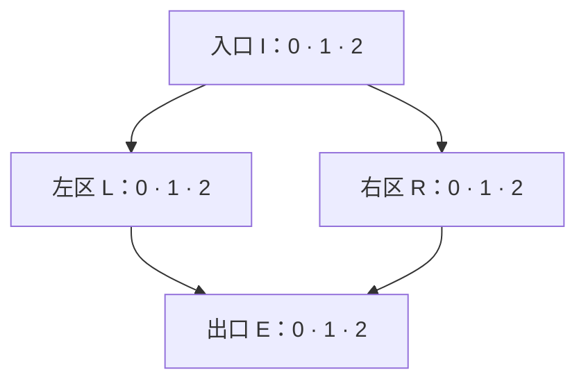

# Tide：从局部计算走到完整模型

本脚本面向首次接触 Tide、熟悉顺序神经网络计算的听众。目标是理解去中心化与稀疏化如何牵引结构和局部机制，以及具体机制怎样反过来暴露上层取舍。[简短设计说明](../memos/design/design-requirements-and-architecture.md)保存主张与依据；此处安排逐步讲述和画面变化，供后续制作展示。

六段依次展开，每个停点由讲者推进；停点不预设为一页。主线走完两次计算以后，再展开替代方案。全程区分**已确认目标、定义事实／条件推论、设计解释、待验证判断**。下方“讲者核对”供备查，不要求全部放上画面。

## 1. 从熟悉的顺序计算进入目标

**听众已有：** 输入依次经过若干计算得到输出，残差可以保留输入表示。**本段新增：** Tide 要在内部容量扩大时保持信息与决策的局部性，并在可比任务效果下减少每次参与的节点、连接与工作。

| 停点 | 画面变化 | 讲述要点 |
|---|---|---|
| 1.1 | 只显示“输入 → 计算 → 计算 → 输出” | 先保留熟悉的输入到输出过程。接下来考察内部计算怎样组织，以及每次由哪些部分承担。 |
| 1.2 | 在计算部分下方加入“局部信息与决策”“参与节点与连接” | 目标是内部去中心化与稀疏化；单节点直接通信对象数保持有界，避免所有内部计算依赖固定主干或决策中心。效果可比时，优先减少完整计算与传播。 |

**讲者核对。** 本段说明已确认目标。经过全部区域可以接受，稀疏也可以发生在每个区域内部。设备部署、学习规则另议；“具备本地状态”尚不足以证明这些目标达成。

**出处：** [设计说明 §1](../memos/design/design-requirements-and-architecture.md#1-目标与边界)、[用户对范围与优先级的确认](../records/history/document-revisions.md#2026-10-27确认去中心化范围与稀疏优先级)、[区域覆盖澄清](../records/history/document-revisions.md#2026-10-28区域覆盖与输出读出的讨论澄清)。

## 2. 固定端口下，建立一张小图

**听众已有：** 输入输出边界与内部目标。**本段新增：** 固定端口和有界直接通信使内部扩展需要多跳传播；HB 是一种具体构造。锁定小图后，后续只改变节点、边和状态的显示，不移动区域。

| 停点 | 画面变化 | 讲述要点 |
|---|---|---|
| 2.1 | 在有限入口与出口之间加入连续的局部连接，标出“直接邻居有界” | 保持端口配置并扩大可达内部节点数，信息需要逐步扩散、收拢。不同模型可另选有限端口数；结论分别适用于固定配置下的扩展。 |
| 2.2 | 显示下方四区域布局，每区三个编号圆点；暂不画全部节点边 | 采用已有 HB 三层实例：入口分向左右两区，再到出口区。此后简称入口 I、左 L、右 R、出口 E，节点下标为区内编号。 |
| 2.3 | 高亮 $I_0$ 的四个目标；再以淡线补足其他静态边 | 每个源节点向每个相连区域的同编号、下一编号节点发送，下标按模 $3$ 循环。例如 $I_0$ 连向 $L_0,L_1,R_0,R_1$。固定图共有 $12$ 个节点、$24$ 条内部边。 |

此图只表示区域关系；制作时每框展开三个节点，按上述规则画节点边。蓝色标消息、绿色标状态、金色标控制；收到消息的候选用外圈标记，执行 Full 的节点用实心及文字标记，保证静态画面也能区分。侧栏始终留给当前内容、记忆摘要和输出，底栏留给计数。

**讲者核对。** 本段的多跳结论是有前提的计数推论，不指定唯一拓扑。一个应用输入在本例注入三个固定图入口；三个图出口的记录经 ReadOut 形成一个应用输出。应用边界与图端口须各自标清。无界端口仅保留在[范围外答疑记录](../records/history/document-revisions.md#2026-10-28无界端口仅作为范围外答疑)，不展开为本场设计任务。

**出处：** [多跳计数与证明](../memos/design/design-requirements-and-architecture.md#附录-a固定端口下的可达范围)、[HB 拓扑](../topologies/hb-lattice.md)、[实例 §1.4](../instances/hb-lattice-weighted-message.md#14-输入读出与任务)及 [§2](../instances/hb-lattice-weighted-message.md#2-三层图上的分叉汇合与记忆)。

## 3. 完成第一次输入到输出

**听众已有：** 小图及邻接规则。**本段新增：** 收到、记住、提供选择依据、执行 Full 是不同作用；区域选择后形成一条完整运行路径。

| 停点 | 画面变化 | 讲述要点 |
|---|---|---|
| 3.1 | $h_0=+1$ 注入 $I_0,I_1,I_2$；三者出现候选外圈和绿色“+1” | 消息记为“强度、内容”，本次均为 $(1,+1)$。三个入口节点先写入；各自长期摘要为 $1$。 |
| 3.2 | 入口旁出现评分 $(1/2,-1/4,-2)$、控制 $(1,0,0)$；仅 $I_0$ 实心 | 区域按候选描述共同分配。本例选择 $I_0$ 执行 Full；另外两个节点的写入仍保留。此例 Full 原样输出当前内容，记忆参与评分。 |
| 3.3 | 四条消息从 $I_0$ 到 $L_0,L_1,R_0,R_1$；两区各自写入并高亮 $L_0,R_1$ | 左右区域分别在收到消息的两个候选中选择。其余两个节点本次没有接收，也不进入这次选择。 |
| 3.4 | $L_0$ 向 $E_0,E_1$、$R_1$ 向 $E_1,E_2$ 发送；标出接收强度 $(1,2,1)$ | $E_1$ 收到两条，其他两个各一条。聚合内容仍都是 $+1$；本例写入权重截断为 $1$。出口区选择 $E_1$。 |
| 3.5 | 仅 $E_1$ 的端口出现 $(1,+1)$；侧栏形成 $O_0=+1$、$y_0=2$ | 其他图出口缺席。ReadOut 得到图读出 $O_0$，再按外部残差 $y_0=h_0+O_0$ 得到模型输出。第一轮已经完成。 |
| 3.6 | 冻结路径；底栏显示“候选 10／Full 4／内部消息 8／区域 4” | 全部四个区域都参与，但只做四次 Full、使用八条内部连接；候选准备比 Full 多。外部注入和端口输出另计。 |

**讲者核对。** 图上的逻辑时间依次为 $1,2,3$，播放速度不代表执行延迟。进入后层后仍保留前层的状态标记。这里使用正温度二次约束分配，给定参数恰好得到零或一控制；先讲结果，求解条件留在附录 A。$O_0$ 是图读出，$y_0$ 是应用表示；这个标量例子尚未接词表预测头。

**出处：** [HB 完整数值例子](../instances/hb-lattice-weighted-message.md#2-三层图上的分叉汇合与记忆)、[接收与记忆](../local-semantics/weighted-message/architecture-learning-note.md#3-状态与记忆描述)、[读出](../local-semantics/weighted-message/architecture-learning-note.md#44-图的输出读出)。

## 4. 第二次输入让历史可见

**听众已有：** 一次完整路径与第一次保留的状态。**本段新增：** 不执行 Full 的节点仍能记住接收；历史可以参与未来选择，不同接收路径形成不同局部状态。

| 停点 | 画面变化 | 讲述要点 |
|---|---|---|
| 4.1 | 淡化第一轮消息，保留绿色记忆；注入 $h_1=-1$ | 三个入口再次写入，历史简记为 $[+1,-1]$，长期摘要为 $0$。这是第二次输入，不是上一轮动画的重播。 |
| 4.2 | 放大 $I_1$：$s_1=3/4-M_{I_1,\mathrm{long}}$；评分变为 $(1/2,3/4,-2)$ | $I_1$ 第一次没有发送，但记忆被保存。本次描述使用新状态，入口改由 $I_1$ 执行 Full。 |
| 4.3 | 消息到 $L_1,L_2,R_1,R_2$；高亮 $L_1,R_2$ | 新路径让部分节点再次收到，另一部分第一次收到。并排显示 $L_1$ 的 $[+1,-1]$ 与 $L_2$ 的 $[-1]$，摘要分别为 $0,-1$。 |
| 4.4 | 高亮 $L_1\to E_1,E_2$、$R_2\to E_2,E_0$；显示接收强度 $(1,1,2)$，再到 $E_1$ 输出 | 出口仍选 $E_1$，此次 $O_1=-1$、$y_1=-2$。两轮的激活路径不同，候选、Full 和消息计数都仍为 $10,4,8$。 |

**讲者核对。** 第二轮逻辑时间为 $6,7,8$。列表只展示 KV 中的 value 历史；完整状态还包括时间、权重、key 和摘要等字段。本例 Full 不用历史改变输出内容，因此这里只据数值说明记忆参与评分和路径变化；不能据此宣称历史提升了任务效果，也不能断言删掉第一次记忆必然改变第二次胜者。

**出处：** [HB 实例 §2](../instances/hb-lattice-weighted-message.md#2-三层图上的分叉汇合与记忆)、[KV 状态定义](../local-semantics/weighted-message/kv-memory-learning-note.md#1-状态与接收写入)。

## 5. 从完整例子回看共同框架与可选机制

**听众已有：** 两次计算的图、状态、选择与输出。**本段新增：** 哪些职责属于共同框架，哪些属于拓扑或带权支线；一个需求可以由多种绑定回应。

| 停点 | 画面变化 | 讲述要点 |
|---|---|---|
| 5.1 | 在已完成的入口区旁依次标出 P、S、U、F，并指回对应动作 | P 聚合接收、形成候选状态和描述；S 区域共同选择；U 确定本次计算快照与下一持久状态；F 由激活者完成 Full。一般框架允许不同状态采用规则；本例所有候选保留写入。 |
| 5.2 | 在原图上增加三个边注：连接与时间、节点／区域接口、局部计算 | 拓扑确定消息能到哪里；共同框架确定状态和接口的依赖；局部语义给出实际函数。带权 KV 是已经走通的一种完整绑定。 |
| 5.3 | 保留节点位置，放大一个节点的“状态 → Mem → Describe → 区域”链路；旁边加上当前接收 | Mem 提供记忆描述，Describe 结合当前信息形成候选描述。选择要参考历史，可以使用摘要或查询；KV、循环矩阵的状态形式不同，接口职责可以衔接。 |
| 5.4 | 依次加入下方候选比较，每次只展示一行 | 比较时声明换了什么、保留什么，以及哪些成本或性质要重查。 |

| 选择位置 | 相容的比较方向 | 需要重新判断 |
|---|---|---|
| 拓扑与区域 | HB 与全连接分层；分别考察增宽和增深 | 直接邻居、区域协调、候选数与传播深度 |
| 记忆与描述 | KV 的 sum／qry；相容的循环记忆绑定 | 描述保留的信息、读写成本、状态大小与组合条件 |
| 区域选择与发送 | 独立／区域 Attention 评分；二次分配／硬选择等发送规则 | 额外协调、激活支持、发送总量、连续性及学习表现 |

**讲者核对。** 上表是候选关系，不是优胜排序。Read 在正典中保持一般性，Mem 的两个通道属于带权支线；独立评分之后仍有区域共同分配。本段解释当前职责与理由，不把讲述顺序写成架构形成史。

**出处：** [TimedDAG §4—5](../timed-dag-region-selector-learning-note.md#4-节点的局部函数)、[共同局部架构 §3—5](../local-semantics/weighted-message/architecture-learning-note.md#3-状态与记忆描述)、[HB 替代绑定](../instances/hb-lattice-weighted-message.md#4-局部选择与配置实例)、[全连接实例](../instances/fully-connected-layered-weighted-message.md)。

## 6. 成本怎样反过来推动设计

**听众已有：** 目标、完整计算和可替换的位置。**本段新增：** 上层目标约束接口与结构，下层行为反过来要求重审这些选择；结构事实与任务收益需要不同证据。

| 停点 | 画面变化 | 讲述要点 |
|---|---|---|
| 6.1 | 回到固定小图和“10／4／8”，下方展开“准备＋选择＋Full＋消息” | 少做 Full 后，候选更新和描述读取仍可能占主要成本。需要同时考察邻域、区域大小、Mem 查询和描述复杂度。实现中的填充行算术还会影响设备工作量。 |
| 6.2 | 显示两条反馈环：“减少 Full → 选择前描述 → 准备成本 → 重审结构”；“历史参与选择 → 记忆描述 → 模块差异 → 明确接口” | 上层提出所需信息与成本约束，下层揭示具体取舍。更换绑定可处理部分问题；改变 Full 与状态的核心依赖则需重新论证语义。 |
| 6.3 | 画面分列“已演示”“待比较” | 已演示有界邻接、局部状态、区域选择与两轮稀疏路径。局部历史是否改善选择、可比质量下是否减少总工作，仍需任务实验。 |
| 6.4 | 显示“token 嵌入 → Tide 表示 → 词表分布”，旁边列质量与参与数量 | 实验优先采用 Next Token 预测上的单输入单输出。声明数据、上下文、读出和效果容差，再比较节点、连接、Full、消息与实际成本。 |

**讲者核对。** 本场的输出 $y_t=\pm2$ 用于核对机制。词表分布由另一个任务绑定产生，不把标量算例当作语言模型成绩。参与数量统计与设备耗时分别记录；应用单输入单输出也不要求图内部恰好只有一个入口节点和一个出口节点。

**出处：** [设计说明 §4](../memos/design/design-requirements-and-architecture.md#4-局部行为怎样反过来推动上层设计)、[共同架构工作量](../local-semantics/weighted-message/architecture-learning-note.md#s2-工作量)、[既有实现审视 §3.3](../records/reviews/2026-10-28-ascend-implementation-review.md#33-常驻设备路径保留数学稀疏但仍执行填充行上的算术)、[改变 Full 依赖](../timed-dag-region-selector-learning-note.md#134-让完整输出改变后续状态或选择)、[语言模型接入](../memos/training/weighted-message-research-questions.md#21-语言模型接入)。

## 附录 A：讲者使用的数值底稿

整场沿用 [HB 实例 §2](../instances/hb-lattice-weighted-message.md#2-三层图上的分叉汇合与记忆)，不混入其他教学图的参数。

| 项目 | 固定绑定 |
|---|---|
| 图 | $b=2,h=1,n=3,N=2$，基础区域关系，偏移 $\{0,1\}$；I、L、R、E 分别对应 $(1,\varnothing),(2,0),(2,1),(3,\varnothing)$ |
| 时间与边界 | $D=5$；输入 $+1,-1$，处理时间 $1,2,3$ 与 $6,7,8$；每次向三个图入口注入，$W_{\mathrm{out}}=\alpha_{\mathrm{out}}=1$ |
| 记忆与状态采用 | KV，sum，Read$^+$；全部候选保留接收更新，区域历史为单点；无限窗口、无位置旋转、零距离偏置 |
| 数值参数 | $d=d_s=H_{\mathrm{att}}=d_h=r_a=1$，$\epsilon=1$；聚合残差尺度为零；共享基座 $[0;\sqrt2]$、适配器零、摘要投影 $\sqrt2$，短期率 $\log2/D$，长期率零 |
| 评分与分配 | 独立评分，拼接评分隐藏宽度 $d_r=2$；固定增益 $1$，$k=1,\eta=0,\tau_{\mathrm{sel}}=1/8$，quad；正典容量 $K=3$ |
| 完整内容 | $\alpha_{\mathrm{att}}=\alpha_{\mathrm{ff}}=0$，因此 $G_v=u_v$；未使用参数取零，其他宽度按原例 |

入口评分为 $(1/2,3/4-M_{I_1,\mathrm{long}},-2)$，其余三区评分按节点编号分别为 $L:(2,1,0)$、$R:(0,1,2)$、$E:(0,2,0)$，只使用实际候选的分量。每次候选上限均为 $1$、发送总量被约束为 $1$。最大评分与次大评分的间隔均大于 $1/8$，所以二次分配给出下表的一位激活；$k=1$ 本身不普遍限制激活数量为一。

| 输入 | 区域 | 候选编号 | 接收强度，按 $0,1,2$ | 控制，按 $0,1,2$ |
|---|---|---|---|---|
| $+1$ | I | $0,1,2$ | $(1,1,1)$ | $(1,0,0)$ |
| $+1$ | L | $0,1$ | $(1,1,0)$ | $(1,0,0)$ |
| $+1$ | R | $0,1$ | $(1,1,0)$ | $(0,1,0)$ |
| $+1$ | E | $0,1,2$ | $(1,2,1)$ | $(0,1,0)$ |
| $-1$ | I | $0,1,2$ | $(1,1,1)$ | $(0,1,0)$ |
| $-1$ | L | $1,2$ | $(0,1,1)$ | $(0,1,0)$ |
| $-1$ | R | $1,2$ | $(0,1,1)$ | $(0,0,1)$ |
| $-1$ | E | $0,1,2$ | $(1,1,2)$ | $(0,1,0)$ |

表中非候选用零补位，实际只对候选求值。每次候选 $3+2+2+3=10$、Full $1+1+1+1=4$、内部消息 $4+2+2=8$；三次外部注入和一次实际端口输出另计。两次输入共 $20$ 次候选作用，涉及 $12$ 个不同节点；共 $8$ 次 Full，涉及 $7$ 个不同节点。作用次数与不同节点数分别报告。

## 附录 B：已有素材怎样接入

| 素材 | 本脚本中的用法 |
|---|---|
| [结构图](../figures/tide-structure.png)、[P/S/U/F 简图](../figures/PSUF-simple.png)与[详图](../figures/PSUF-complete.png) | 参考结构与接口表达；主线始终保留本脚本的 HB 节点布局 |
| [带权流程图](../figures/weighted-message-flow.svg) | 第 5 段局部放大的结构参考，使用当前例子的状态和值 |
| [两次接收图](../figures/remember-before-send.svg) | 可作记忆专题的独立补充；它采用另一套硬选择算例，本场用 HB 正温度二次分配的两轮数值 |
| [KV](../figures/kv-memory.svg)、[仿射／Delta](../figures/affine-delta-memory.svg) | 第 5 段之后按需要展开记忆专题，先说明模块输入、输出与前置知识 |

可编辑来源与生成方法见[教学图集](../figures/README.md)。制作时以每个停点为可保存状态；短动画只演示消息移动、写入和跨次保留，静态导出保留路径、数值与状态变化。页数、时长、播放器与导出形式在制作阶段决定。
